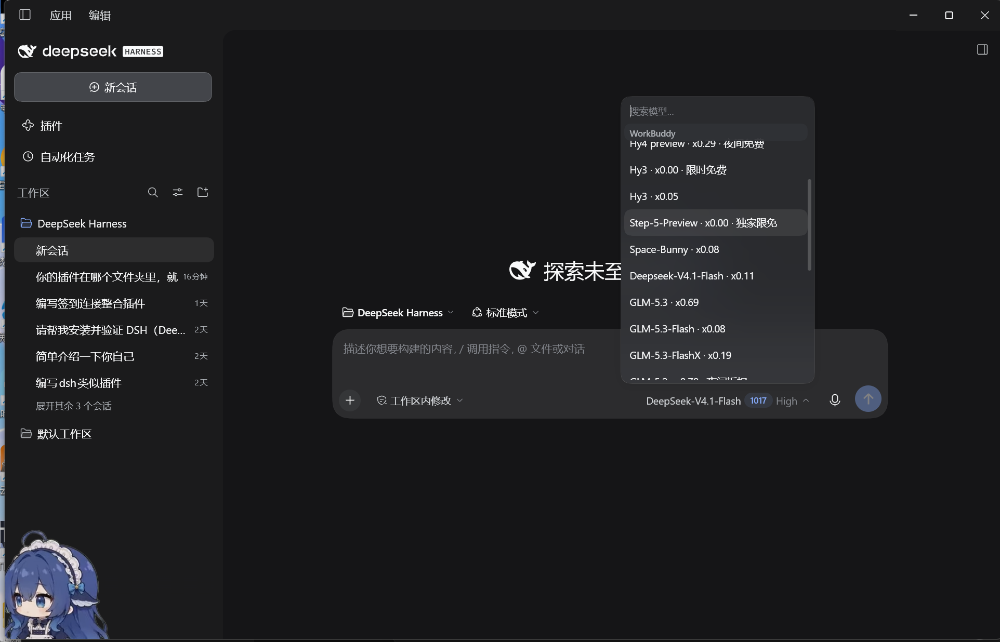
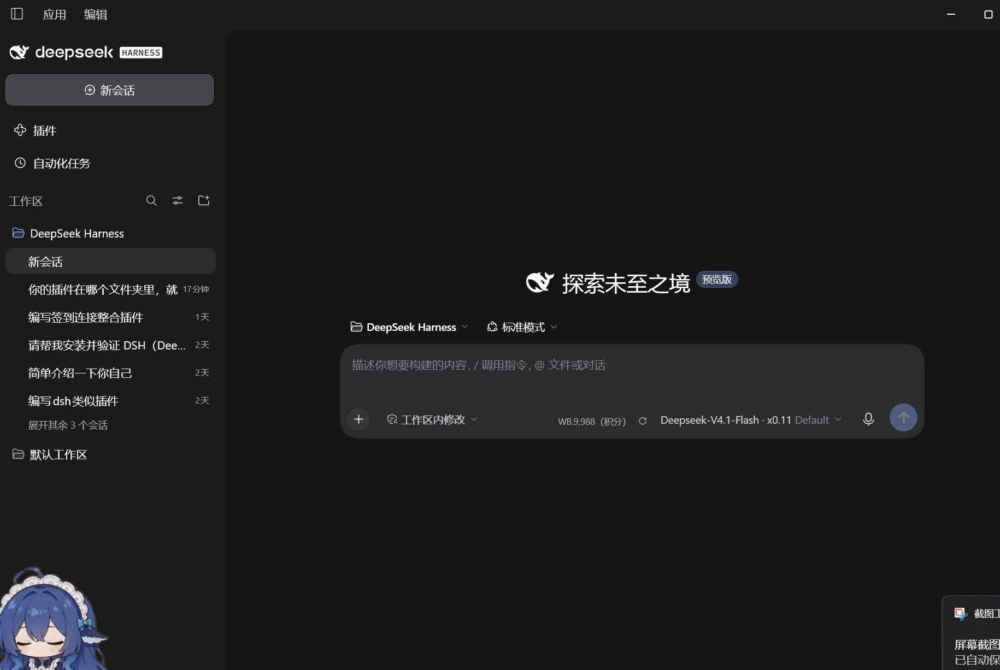
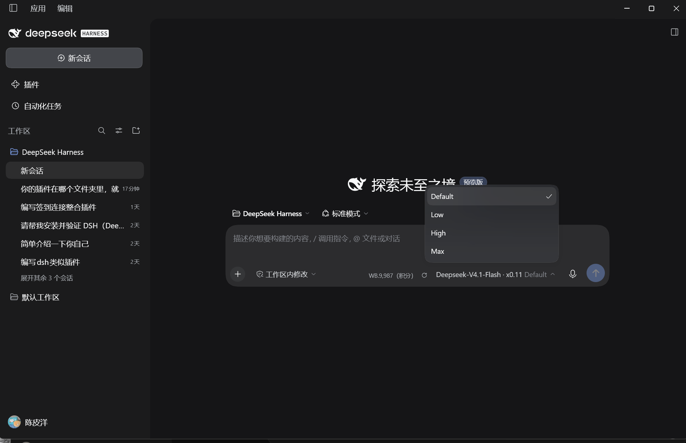
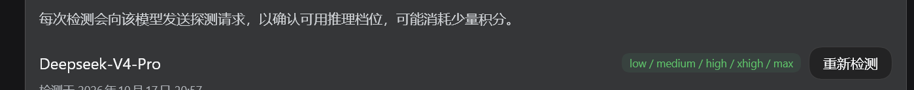
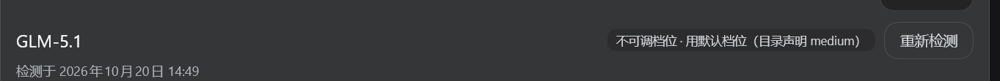
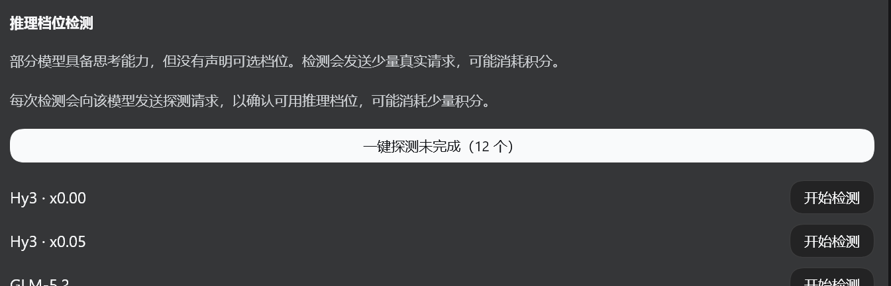
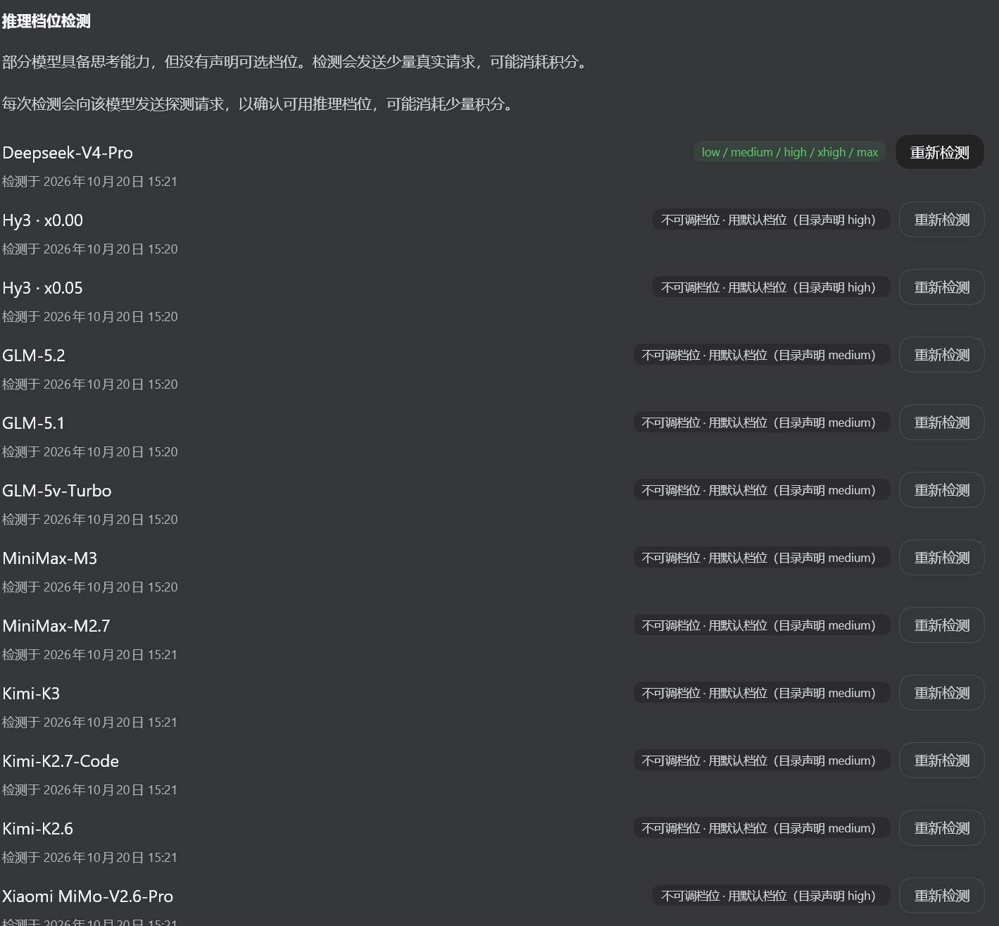

# DSH Buddy Suite

[](https://dsh-plugin.org/plugins/chenpiyanghappy/dsh-buddy-suite)

> **状态**：已发布 `v0.1.1` ✅ — [GitHub](https://github.com/chenpiyanghappy/dsh-buddy-suite) · [CNB](https://cnb.cool/chenpiyanghappy/dsh-buddy-suite) · [npm](https://www.npmjs.com/package/dsh-buddy-suite)

> 把 WorkBuddy 桌面端的模型接入 DeepSeek Harness，并自动完成每日签到。**模型接入同时覆盖国内版（WorkBuddy）与国际版（WorkBuddy AI）两套账号**；签到面向本机全部国内版账号。

`dsh-buddy-suite`（插件节点 id `llm-workbuddy-suite`，provider `workbuddy-suite` / `workbuddy-ai-suite`）是一个 [DeepSeek Harness](https://github.com/DeepSeek-V3/DeepSeek-Harness) 的 cordis 插件，把原本需要两个独立流程才能做完的事合并到一起：

1. **模型接入**：通过本机 loopback 的 OpenAI 兼容 shim，把 WorkBuddy 桌面客户端里的模型接入 DeepSeek Harness。支持 `cn` / `global` 两个区，覆盖流式对话、工具调用、推理力度档位、积分余额与过期预警。
2. **每日签到**：在 DeepSeek Harness 启动与会话面板交互时，自动为所有本机 WorkBuddy 国内版账号完成每日签到（CN-only；国际账号会被上游私有端点拒绝）。签到幂等、失败重试、跨午夜惰性滚动。

两半只共用一个**凭证解密模块**（用 App 自带的 Electron 解密本机 at-rest 凭证），彼此独立、任一半失败都不影响另一半。

> **是的，它是一个替代品，不是补充品。** 装本插件即可，**不要再装** `dsh-workbuddy-connect` 或 `dsh-buddy-checkin`——它们分别是本插件的两半。`dsh-buddy-checkin` 自 `0.4.0`（2026-10-10）后未再更新，在新内核上会被 DSH 拒绝安装，签到这部分正是由本插件接手的。

---

## 截图

模型选择器 —— WorkBuddy 国内版模型直接出现在 DSH 的模型列表里，右侧标出每次调用的积分单价：



输入框旁的积分徽标 —— 随时看到当前账号剩余积分（可一键关闭，见下方「余额/档位显示开关」）：



推理档位选择器 —— 探测出可用档位后，直接在输入框切换：



推理档位探测 —— DeepSeek-V4-Pro 检出 5 档（low / medium / high / xhigh / max）：



不可调档位的模型 —— GLM-5.1 被判定为「不可调档位」，回落到目录声明的默认档位（medium），而不是笼统的「检测未完成」：



一键批量探测 —— 把还没探测过的模型一次跑完（执行前会先报价）：



批量探测完成 —— 12 个模型逐个给出结论（可调档位的显示档位，不可调的回落到默认档位）：



---

## 安装与构建

本插件通过 `cordis.patch.yml` 注入 DeepSeek Harness 的 profile（**不修改默认模型**）。

```bash
pnpm install
pnpm build     # tsdown 构建产物到 lib/
pnpm test      # vitest 运行测试
pnpm check     # 类型检查 + 测试 + 构建
```

构建产物 `lib/` 与 `cordis.patch.yml` 由宿主（DeepSeek Harness）按 cordis 插件方式加载。

## 已发布版本

**推荐用 DeepSeek Harness 自带的插件管理器安装**（会写入对应 profile 的 `cordis.patch.yml`，无需手工构建）：

```bash
# profile 名按你自己的改：web / desktop / tui
dsh plugin --profile web add dsh-buddy-suite
```

也可以用 npm 安装后由 DSH 按 cordis 插件方式加载：

```bash
npm install dsh-buddy-suite
```

安装后由 DeepSeek Harness 按 cordis 插件方式加载（通过 `cordis.patch.yml`）。当前最新版本 `v0.1.1`，发布渠道：

- **GitHub**：https://github.com/chenpiyanghappy/dsh-buddy-suite
- **CNB**：https://cnb.cool/chenpiyanghappy/dsh-buddy-suite
- **npm**：https://www.npmjs.com/package/dsh-buddy-suite

## 功能要点

- **模型接入（upstream / shim / adapter）**
  - 每个变体（`workbuddy-suite` 国内 / `workbuddy-ai-suite` 国际）注册一个 provider。带 `-suite` 后缀是为了在「误装两个插件」时不静默覆盖对方，正常使用只有本插件时不影响任何行为。
  - 本机起一个 loopback 的 OpenAI 兼容接口，把 WorkBuddy 上游协议包装后交给 DeepSeek Harness 的 `llm-pi-ai` 扩展点调用；流式、工具调用、上下文压缩、权限均留在宿主侧。
  - 模型目录单飞抓取、按账号显隐、reasoning 档位探测、心跳文件给 CLI 看状态。
  - 积分过期按 24h / 3d / 7d 分桶预警，避免「500 积分其实是 1 小时后过期」的坑。
- **每日签到（checkin）**
  - 扫 `CodeBuddyExtension/Data/Public/auth` 发现本机所有账号；明文 / at-rest key 双路解密凭证。
  - 仅在启动 + 面板交互时签（上游只认「今天」，定时任务纯属浪费请求）。
  - 已签 / 已领过的账号重启不再重复请求；失败项单独重试。
- **推理档位探测（reasoning levels）**
  - 逐模型探测该模型接受哪些推理档位；判定为不可调档位时回落到目录声明的默认档位，而不是笼统的「检测未完成」。
  - **一键批量探测**：把还没探测过的模型一次跑完（卡片上显示剩余个数），执行前先按模型档位数**报价**再确认，避免一次批量探测悄悄吃掉大笔积分。
  - 探测未完成时显示**具体原因**（被拒的是哪个参数、上游回了什么），不是一个无信息的死路。
  - 探测结果按账号与 catalog 行指纹记账：目录行一变就重新探测，与上游插件**各存各的**，互不作废。
- **安全边界**
  - 同源路由只收 loopback 请求（Host / Origin 双校验防 DNS 重绑定）。
  - 跨给浏览器的字段全部过滤 token（JWT 与 `token=xxx` 正则打码）。
  - 凭证只在本机解密，不离开设备。

## 输入框显示开关

输入框右侧会显示两项信息：**余额速览**（当前账号剩余积分）和**推理档位入口**。

它们对普通用户有用，但有两类人会被打扰：已经用别的插件显示余额的人（同一个数字看两遍），以及经常在多个供应商之间切换的人（同样的控件出现两套）。

在插件卡片（`设置 → 插件 → 本插件`）的「状态」页里有「输入框显示」一节，两个勾选框可以分别关掉它们：

| 开关 | 关掉后 |
|---|---|
| 显示余额速览 | 隐藏积分数字**和**旁边的 ↻ 刷新按钮（没有数字时刷新按钮没有意义） |
| 显示推理档位入口 | 隐藏推理档位图标及其全部气泡提示 |

两者**默认都开启**——不打开的普通用户能看到功能，介意的人可以自己关。两项独立，关一个不影响另一个。

偏好保存在 `$DSH_HOME/.workbuddy-ui-preferences.json`，**按机器保存而不是按账号**：切换账号不会把已关掉的显示项重新打开。文件缺失或损坏时回退为「全部显示」。

> 当前 DSH 0.2.x 已移除插件的 settings section API，所以这个开关无法注册成宿主设置项，只能由插件自管理的文件承载。

## 与上游项目的关系（引用说明）

本节说明本项目代码与哪些开源项目存在继承或参照关系，以便溯源与致谢。

- **[corrinehu/dsh-workbuddy-connect](https://github.com/corrinehu/dsh-workbuddy-connect)**（MIT，npm `dsh-workbuddy-connect@0.7.8`）
  本项目的「模型接入」半**直接派生自**该已发布插件：同样的 cordis 架构、loopback shim、adapter 与 `cordis.patch.yml` 套路。`dsh-buddy-suite` 是其**超集**——在模型接入之外，额外合入了「每日签到」半。
  致谢：本项目维护者 `@chenpiyanghappy` 的 **PR #156** 已合入 dsh-workbuddy-connect v0.7.8（适配 DSH 0.2.1-rc.2）；WorkBuddy 另递 PR #159 / #164。

- **[Sliverkiss/workbuddy2api](https://github.com/Sliverkiss/workbuddy2api)**（MIT，Go 实现）
  上游 wire 协议（聊天 SSE 流式、token 刷新、模型目录、积分余额）的参照实现；本项目 `src/upstream.ts` 的协议行为**移植自**它。
  ⚠️ 该仓库现已 404（删除或转为私有），仅在 dsh-workbuddy-connect 的 README 与本项目代码注释中留有致谢。

- **[franksong2702/dsh-codex-connect](https://github.com/franksong2702/dsh-codex-connect)**（Apache-2.0）
  插件目录结构、provider 注册方式的参照。

## 免责声明

本项目仅供**个人学习与研究**使用，与腾讯、WorkBuddy、DeepSeek 及其关联方**无任何隶属或合作关系**。

本项目依赖 WorkBuddy 桌面客户端的**私有接口**（非官方公开 API）。WorkBuddy 客户端更新可能导致本项目需要相应调整；由此产生的兼容性问题由使用者自行承担，请遵守相关服务条款。

## 许可证

[MIT](./LICENSE) © chenpiyanghappy
